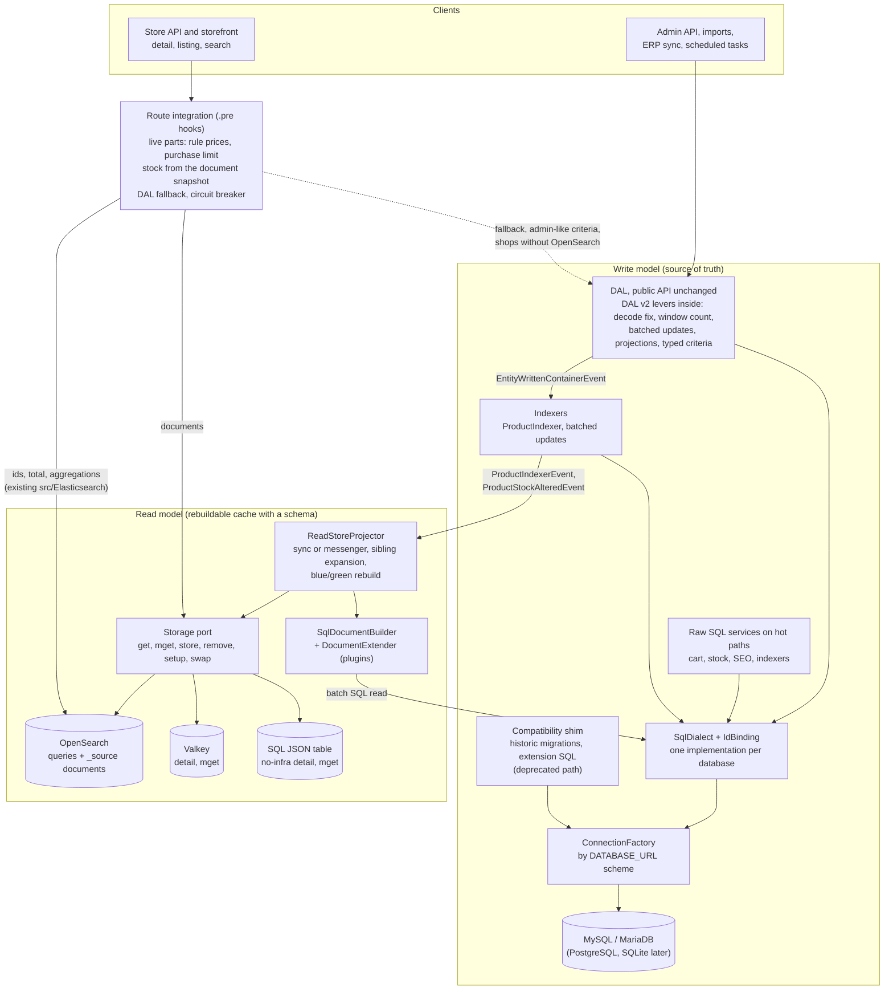

# 46 Target architecture after waves 1 to 10

Status: 2026-11-25, updated after wave 10 (originally written 2026-11-24 after wave 9).
This doc puts the results of waves 1 to 10 into one picture: the write side (`SqlDialect`, DAL v2) and the read side (O1+ read store), why each layer looks the way it does, and the order in which the core gets there.
Every number links to the doc it comes from.

What changed after wave 10 and why:

- "What is not proven" was rewritten with explicit verdicts per point from `docs/47` to `docs/51`: O1a (`_source` hydration) is now built and measured; OpenSearch custom-field scaling limits are mapped; integration suites outside the DAL are down to 90 PostgreSQL-only failures across 8,072 tests; PostgreSQL production setup (replicas, TLS, OpenSearch, workers, PgBouncer) ran end-to-end; and every headline comparison now carries a paired AB/BA 95 % bootstrap CI on a quiet host.
- Section 4 and the roadmap note two refinements from wave 10 D (`docs/51`): DAL v2 *with* the wave 8 levers improves 150k reads by 1.24× to 2.15× (`17.4` vs `14.1 req/s` at c=8, disproving doc 38's "no change" statement measured without levers) while remaining 43× below O1a (`756 req/s`), so the O1+ architecture holds; and OpenSearch's 1 s `refresh_interval` poisons Shopware's HTTP cache on immediate invalidation under `refresh=false` (5/5 trials), which E6.02/E6.04 must guard against.
- TL;DR, diagram, and phase order did not change: every architectural choice held under wave 10 verification.

Earlier partial pictures:

- `docs/10-architecture.md` "Target architecture": write side only, after wave 2.
- `docs/27-final-report.md` "Integration plan": phases 0 to 4, before waves 8 and 9.
- `docs/29-orm-alternatives.md` "Recommendation": DAL v2, wave 8.
- `docs/38-read-store-plan.md` "Conclusion": O1+, wave 9.

## TL;DR

- Write model: keep the DAL as the public API and make it faster from the inside (DAL v2), on top of a `SqlDialect` per database; the MySQL-to-X translator stays only as a shim for old migrations and extension SQL.
- Read model: storefront product reads come from a product document (`ProductDocument`), served from OpenSearch `_source` or Valkey through a narrow `Storage` port, with queries on the existing OpenSearch code; no multi-engine query port.
- The two sides meet in one place: a projector fed by `ProductIndexerEvent`, which rebuilds documents from the write database.
- Order: MySQL hygiene and DAL v2 first (they pay off on MySQL alone), the dialect groundwork next (no PostgreSQL code), PostgreSQL only after a business decision; the read store is independent of the database question and can start in parallel.

## Diagram

## Layers and why

### 1. One code base, the database chosen by `DATABASE_URL`

`ConnectionFactory` picks a factory per scheme; each factory owns session setup, middlewares and exception mapping (`docs/10` "Connection per platform").
Why: switching databases must not need a different build, and per-database setup belongs in one place, not in every caller.

### 2. `SqlDialect` and `IdBinding` instead of a translator

SQL that differs per database is generated by a dialect method (`upsert`, `groupConcat`, `json*`, `caseInsensitive`, `idToText`, ...); code above the connection passes ids as hex strings and `IdBinding` binds them per database (`docs/10`, `docs/15`, `docs/summary.md` "`SqlDialect`").
Why:

- The translator found the differences fast but rewrites every statement at runtime, hides what the database runs, and lets MySQL stay the reference (`docs/10` "Why this is not the target", `docs/17`, `docs/25`).
- The dialects are small: MySQL 180 lines, PostgreSQL 258, SQLite 222, MariaDB 19 (`docs/summary.md`).
- On MySQL alone the dialect makes the remaining MySQL-only SQL visible and testable; it does not need a second database to be useful.

The translator stays as a compatibility shim, because 910 historic migrations and the raw SQL of extensions depend on it: 12.7 % of 3,747 store plugins run only through the shim, 29.9 % have MySQL-only DDL in migrations (`docs/28`).

### 3. DAL v2: keep the DAL, change its inside

The DAL stays the public read and write API for the admin, imports, plugins and apps.
DAL v2 is a set of internal levers first (write gateway decode fix, window count, fused min/max, batched updates, partial reads), then additive API (projections, typed criteria field paths, attribute entities) (`docs/29` "Recommendation", `docs/33`).
Why:

- DAL v2 with all levers is 1.7 to 3.3 times faster than the DAL on reads on all four engines (`docs/34`).
- Doctrine ORM and Cycle ORM pass the probes only with hand-written translation, inheritance and version code, write one statement per row, and a replacement costs 100 to 230 person-weeks with a break of every plugin and app, against 11 to 27 person-weeks without a break for DAL v2 (`docs/29`).
- Writes stay the weak spot (writer PHP is 58 to 59 % of the bulk write, `docs/33`), so the write path is the next lever, not a new API.

### 4. Read model: O1+ for the storefront

Storefront product detail, listing and search read a `ProductDocument` (one per product, all languages, versioned schema) from a narrow `Storage` port.
Queries (filters, `displayGroup` collapsing, `postFilters`, aggregations, word search) stay on the existing `src/Elasticsearch` code; only the hydration moves from SQL `cloneForRead($ids)` to OpenSearch `_source` or Valkey `MGET` (`docs/38` "Conclusion").
Why:

- At 150,000 products and c=8, the DAL serves 14.1 req/s and DAL v2 with all wave 8 levers serves 17.4 req/s (+24 %, still saturating 8 MySQL cores, `docs/51` 3c; wave 9's ~10 req/s ran DAL v2 without levers); today's OpenSearch path (O1) serves 532 req/s, and O1a (`_source` hydration) serves 756 req/s while cutting MySQL CPU by 84 % (`docs/47`, `docs/51` 3e).
- Detail from Valkey, MongoDB or SQL JSON takes 0.14 to 0.27 ms against 6.2 ms on the DAL, with 0 product SQL (`docs/summary.md` "Wave 9").
- A multi-engine query port (O2) costs 40 to 68 person-weeks against 22 to 37 for O1+, and its engines lose to OpenSearch on every query scenario; standalone stores keep the SQL keyword interpreter for word search (574 ms or more against 25.5 ms on O1) (`docs/38` Q8, R3b).
- The document is its own read contract, decoupled from the table layout: a storage change on the write side is no longer an API change for the storefront.
  Store API responses keep the `SalesChannelProductEntity` shape so subscribers, app scripts and Twig keep working (`docs/44`).

Engines in order: OpenSearch `_source` (no new infrastructure where OpenSearch runs), Valkey (already in most production setups), SQL JSON as `Storage` only (shops without extra infrastructure, and the publish table if one builder ever feeds two stores) (`docs/38` "Engines in order").

### 5. Live parts stay live

Rule prices, customer group prices, tax, rounding and the purchase limit (`calculatedMaxPurchase`) are calculated at read time on top of the document (`ProductSubscriber`), not pre-resolved in it (`docs/38` Q6, `docs/44`).
Why: they depend on the cart and customer context, and pre-resolving them per rule multiplies the document count.

Stock is not live.
`stock`, `availableStock`, `available` and `isCloseout` come from the document snapshot (`DocumentHydrator`), and the live `calculatedMaxPurchase` is computed from those snapshot values.
Stock freshness therefore depends on the projector (`ProductStockAlteredEvent`, section 6); during the lag a page can show an old stock or list a sold-out closeout, and checkout validates against SQL (`docs/38` Q6).

### 6. The projector is the only coupling

The projector listens to `ProductIndexerEvent` and `ProductStockAlteredEvent` (as the OpenSearch indexer does today), expands sibling variants, and rebuilds documents with a batch SQL builder that is 4.68x faster than the DAL based builder (`docs/40`, `docs/45`, E6.02).
Why:

- Every DAL and stock write path probed in wave 9 is caught with the projector fixes (`docs/45`).
- The read store can always be rebuilt from the write database; losing it costs a rebuild (46 to 132 s for 150,000 products), not data (`docs/38` Q7).
- Known gaps, accepted for now: raw SQL plugin writes (need `ReadStoreProjector::schedule($ids)` or the next reconciliation), tax and currency changes (async rebuild).
  Change data capture (O4) is a later option, only if raw SQL writes on hot product data turn out to be common (`docs/38` "What would change the recommendation").

### 7. Fallback is explicit

Criteria the bridge cannot translate, shops without OpenSearch and admin-like reads go to the DAL, counted and logged, never silently wrong (`docs/38` "Principles", `docs/44`).

## What was unproven after wave 9 — Wave 10 verdicts

| Point from wave 9 | Verdict | Evidence & limits |
|---|---|---|
| 1. O1+ (`_source` hydration, O1a) end to end | **Proven** (with write-path & cache-window conditions) | Built and measured on 5k and 150k products (`docs/47`, `docs/51` 3e): 50/50 Store API equality, 0 product-read SQL on listing/search, c=8 throughput at 150k rises **1.42×** (`532 → 756 req/s`, CI `[1.32, 1.48]`) and MySQL CPU drops **−84 %** (`15.1 → 2.44 s`, CI `[0.156, 0.163]`). Writes require full re-index via `ElasticsearchIndexer::updateIds()` (partial `_update` drops unstored search fields); immediate HTTP cache invalidation under `refresh=false` poisons the HTTP cache (`5/5` trials, `docs/51` 3d), so invalidation delay must exceed `refresh_interval` or run post-refresh. |
| 2. Full `ProductDocument` in OpenSearch `_source` with many custom fields | **Proven with limits** | Mapped across 0..5,000 custom fields × 1..20 languages (`docs/48`): storing `rs_document` with `enabled: false` avoids the 1,000-field mapping limit (`mapping.total_fields.limit`), which today's app custom-field auto-mapping hits at ~330 fields. Measured index size at 150k is 0.42 GB (0 × 1) to 0.96 GB (100 × 5), extrapolating to 2.7 GB (1,000 × 5) and 53.5 GB (5,000 × 20); per-language duplication and byte-budgeted bulk batching must be fixed in E6.03. Valkey (O1b) does not solve document size (1.08–1.13× JSON). |
| 3. PostgreSQL in production (replicas, TLS, OpenSearch, workers, PgBouncer, non-DAL suites) | **Proven with limits** | **Production stack (`docs/50`, `docs/51` 3f)**: primary + streaming replica, TLS, OpenSearch, workers, and PgBouncer 1.26.1 (transaction mode) all ran end-to-end with 0 walk failures. Full storefront walk total is **1.18×** MariaDB (`750` vs `637 ms`, CI `[1.09, 1.23]`; cached browse steps `1.00–1.05×`, `order` `1.37×`); PgBouncer adds **1.31×** over direct persistent+plan-cache (`1,012` vs `771 ms`, CI `[1.13, 1.38]`). Uncached storefront (persistent + plan cache) holds at **1.13–1.30×** MariaDB (`docs/51` 3a); bulk sync holds at **1.81×** seq / **0.34×** c=4 rps. **Non-DAL integration suites (`docs/49`)**: down from 386 to **90** PostgreSQL-only failures across 8,072 tests (98.9 % pass rate; `Core/System` outside `CustomEntity` = 0, `Storefront` = 1), all classified; `CustomEntity` runtime DDL (8/12) remains the main structural gap (E4.04). |
| 4. Single-machine timings & unmeasured "~10 % noise" floor | **Proven with limits** | Still **one developer machine** (Apple M4 Pro / Podman AppleHV VM); absolute numbers remain host-specific (`docs/51`). Replaced the guess with measured A/A noise floors (`±1.7 %` SQLite CLI, `±3.8 %` pinned MySQL CLI, `±5.7–8.2 %` unpinned DB CLI, `±9.7–11.8 %` HTTP storefront) and 10-round AB/BA 95 % bootstrap CIs (`scripts/wave10-paired.py`). Doc 38's "DAL v2 does not change 150k reads" is **disproven** (levers cut 150k latency 20–54 % and raise c=8 throughput +24 %), while the conclusion that DAL v2 cannot replace OpenSearch at 150k **holds**. |

## Roadmap

The phases of `docs/27` "Integration plan", merged with the epics.
Effort is a judgement in person-weeks for one experienced core developer where the docs have one.

| Phase | Epic | Content | Effort | Breaking | Pays off on MySQL alone |
|---|---|---|---|---|---|
| 0 Decision | – | RFC/ADR from docs 27, 29, 38 and this doc; decide whether PostgreSQL is a goal at all | – | – | – |
| 1 Hygiene | E1 https://github.com/shopware/shopware/issues/23287 | stop relying on lenient MySQL: `ONLY_FULL_GROUP_BY`, savepoints, NULL order, typed parameters | small fixes, weeks | no | yes |
| 1 Performance | E2 https://github.com/shopware/shopware/issues/23300 | batched product indexer updates, indexer row order, keyword score once | weeks | no | yes |
| 1 DAL v2 | E3 https://github.com/shopware/shopware/issues/23304 | internal levers, then additive API | 11–27 (`docs/29`) | no (row 11 later, breaking) | yes |
| 1–2 Read store | E6 (draft, `docs/issues/E6-read-store/`) | `Storage` port, `ProductDocument`, builder and projector, `_source` and Valkey hydration, route integration, surrounding route SQL | 22–37 products (`docs/38`) | no | yes |
| 2 Groundwork | E4 https://github.com/shopware/shopware/issues/23317 | `SqlDialect` service with the MySQL/MariaDB implementation, hex id binding, neutral migration API, custom entity DDL, public dialect and `shopware-cli` check | M to L per item (`docs/10` change list) | yes for extensions with raw SQL on ids, deprecate first | readability, testability, fewer id bugs |
| 3 PostgreSQL experimental | E5 (draft, `docs/issues/E5-postgresql/`) | driver, connection setup, string filter semantics, sort indexes, nightly CI | not estimated | no (new driver) | no |
| 4 PostgreSQL supported | – | CI matrix per PR, performance budget, hosting guidance, OpenSearch and replica tests | not estimated | – | no |
| optional SQLite | – | dialect for local development and single-process CI, after the neutral migration API | not estimated | – | no |

### Is the order right?

Yes, for three reasons:

1. E1, E2 and E3 help every Shopware installation today and need no decision about a second database; they also remove the lenient MySQL behaviour that a second database would expose (`docs/core-findings.md`, 40 findings).
2. E4 is the groundwork any second database needs, but it is worth doing on MySQL alone only in its non-breaking parts (dialect service, neutral migration API); the breaking id work should wait until phase 0 says PostgreSQL is a goal.
   The core developer feedback of 2026-11-23 (not worth the effort, MySQL ecosystem) and the measured gap (storefront 1.13x to 1.46x, writes about 2x) argue for that gate (`docs/27` "Risks").
3. E6 does not depend on the database question: the read store reads from OpenSearch or Valkey and touches SQL only in the builder.
   It depends on E2 (indexer events and batched updates feed the projector) and gains from E3, so it runs after or next to them, not after E4.
   The read path it builds on already scales far beyond the DAL (O1: 453.8 against 10.4 requests per second at c=8, `docs/38` Q7), more than anything a database switch showed; O1+ removes the SQL hydration that is the remaining write database load of that path.

One dependency to watch: `SqlDocumentBuilder` is raw SQL; if PostgreSQL comes later, it moves behind the dialect like every other hot path.

## Core changes per epic

| Epic | Core changes | Sub-issues |
|---|---|---|
| E1 MySQL robustness | DAL group by and natural sorting, `ONLY_FULL_GROUP_BY` on, `StatesUpdater` `HAVING`, `ROW_NUMBER()` instead of session variables, savepoints after failed statements, `MultiInsertQueryQueue` duplicate keys, explicit NULL order, price accessor scale, accent-insensitive search decision, `LockValidator` row count, typed numeric parameters, date custom field cast | E1.01 to E1.12 |
| E2 Performance | batch `ProductIndexer` updates (475 `UPDATE product` per bulk write), indexer row order against deadlocks, keyword score computed once | E2.01 to E2.03 |
| E3 DAL v2 | write gateway primary key decode, window count total, fused min/max stats, batched entity updates, write path profile, partial read of inherited to-many, DTO projections, read shape, typed criteria field paths, attribute entity compiler gaps, classic definitions to attributes (breaking), extension probes | E3.01 to E3.12 |
| E4 Database abstraction | `SqlDialect` service, hex id binding, neutral migration API, custom entity DDL per platform, portable test SQL, extension dialect and `shopware-cli` check | E4.01 to E4.06 |
| E5 PostgreSQL | driver and `PostgreSQLFactory`, connection setup (persistent connections or pooler, plan cache), string filter semantics (`lower()` with `ucs_basic`), sort indexes with NULL order, nightly CI | E5.01 to E5.05 |
| E6 Read store | `Storage` port and `ProductDocument`, SQL document builder and projector, OpenSearch `_source` and Valkey hydration, route gateway and live parts, surrounding route SQL (breadcrumb, configurator, CMS: 23 of 30 detail statements), pointer generation grace GC, DAL keyword terms aggregation count fix | E6.01 to E6.07 |

E5 and E6 are drafts and not filed upstream.

## Next steps

1. Phase 0: an RFC or ADR from this doc (plus `docs/47` to `docs/51`), with the PostgreSQL go or stop as its main decision.
2. File E6 (read store) upstream — O1a is now built and measured (`docs/47`, `docs/48`, `docs/51`), and the wave 10 custom-field, full-reindex, and HTTP cache-window requirements are incorporated into the E6 issue drafts (`docs/issues/E6-read-store/`).
3. File E5 (PostgreSQL) only on a go decision for PostgreSQL, after E4.04 (`CustomEntity` runtime DDL) and the remaining 90 classified integration failures (`docs/49`) are scoped.
