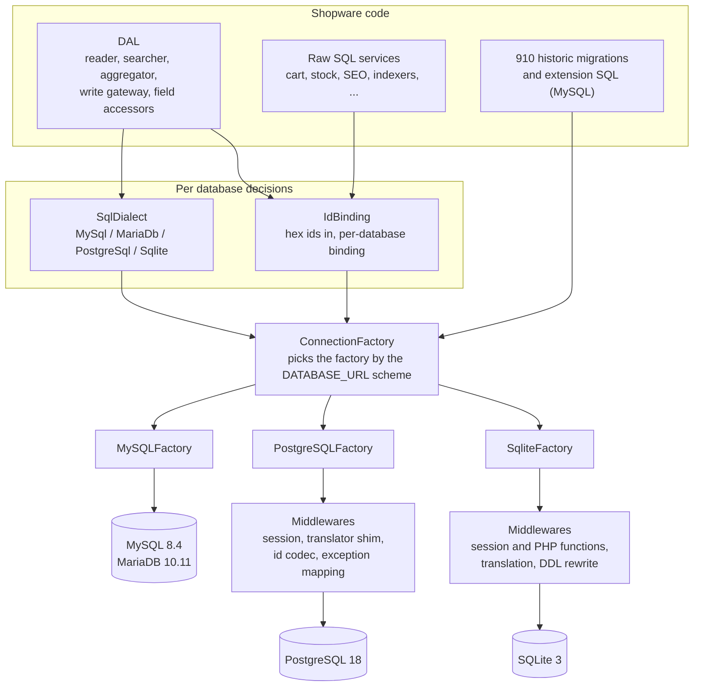
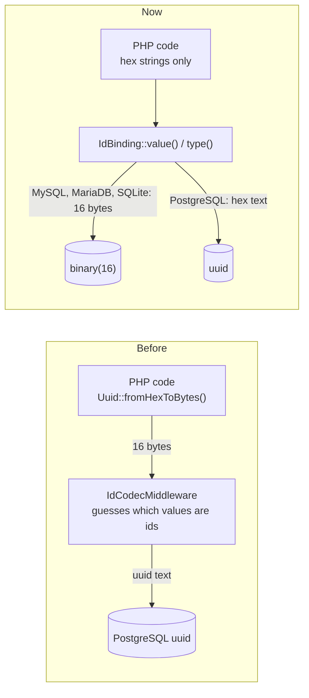
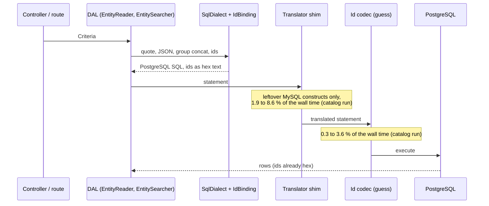
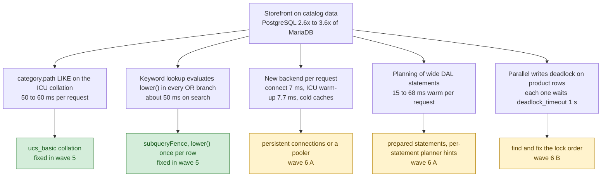
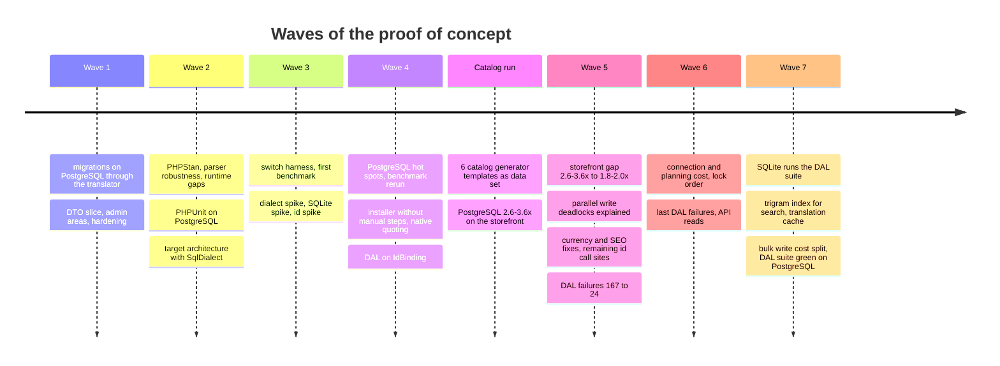

# Summary after wave 7: findings and architecture

State: 2026-11-20, research repo at `7624df5` plus the wave 7 benchmark rerun, instance branch `poc/db-independent` at `87e1768ce3a` (118 commits on trunk `ae0190f5892`, 479 files changed, 14,289 insertions and 2,515 deletions).
Every number below comes from one of the numbered docs, the source is linked in each section.

## In one paragraph

The same Shopware code now installs and runs on MySQL 8.4, MariaDB 10.11 and PostgreSQL 18, and on SQLite, where the DataAbstractionLayer integration suite now runs (795 of 804 tests pass, `docs/24`).
SQL that differs per database goes through a `SqlDialect` per database, ids are hex strings above the connection, and the MySQL-to-PostgreSQL translator is left as a shim for old migrations and extension SQL.
PostgreSQL was 2.6x to 3.6x slower than MariaDB on the storefront with realistic catalog data; wave 5 brought that to 1.8x to 2.0x, and the wave 7 rerun measures 1.5x to 1.9x on the storefront with a new connection per request and 1.1x to 1.5x with persistent connections and the plan cache (`docs/13`, "Rerun after wave 7").
The gap that is left is mostly a fixed cost per request (new backend, planning of wide DAL statements), not the translator and the id codec (1.9 % to 8.6 % and 0.3 % to 3.6 % of the wall time on the catalog run).

## Where we started

Shopware writes MySQL SQL in many places (`docs/01-initial-findings.md`, `docs/04-inventory-summary.md`):

- 446 files use the connection, 241 of them contain MySQL-specific SQL.
- 507 text columns rely on the case-insensitive collation `utf8mb4_unicode_ci`.
- 715 id columns are `binary(16)`, and 309 files outside the migrations convert ids between hex and bytes by hand.
- 910 migrations are written in MySQL DDL.

The first port (waves 1 and 2) put a translator between Shopware and PostgreSQL that rewrites every statement; it found the differences fast but is not a target (`docs/10-architecture.md`, "Why this is not the target").

## Architecture now

### `SqlDialect`

One interface (`instance/src/Core/Framework/Adapter/Database/Dialect/SqlDialect.php`), one implementation per database, chosen by the platform of the connection (`SqlDialectFactory`).
Each method exists because a concrete difference needed it:

| Method | Why it exists | Doc |
|---|---|---|
| `quoteIdentifier()` | backticks against double quotes | 10, 17 |
| `upsert()` | `ON DUPLICATE KEY` reacts to every unique key, `ON CONFLICT` names one | 10 |
| `groupConcat()` | `GROUP_CONCAT` against `string_agg` | 10 |
| `jsonExtract()`, `jsonExtractText()`, `jsonValue()`, `jsonBind()`, `jsonSet()` | `JSON_*` functions against `jsonb` operators | 10 |
| `jsonExtractNumber()` | PostgreSQL has no `text * numeric`, prices in other currencies failed with HTTP 500 | 20 |
| `idToText()`, `idParameterType()`, `idListParameterType()` | `binary(16)` against native `uuid` | 15 |
| `caseInsensitive()` | `ci` collation of MySQL, `lower(col) COLLATE ucs_basic` with an index on PostgreSQL | 16 |
| `subqueryFence()` | forces PostgreSQL to compute `lower()` once per row in the keyword lookup | 18 |
| `rowNumberPerPartition()` | `ROW_NUMBER() OVER (PARTITION BY ...)` on PostgreSQL and SQLite, MySQL keeps its `@n` session variable counter | code |

Implementations are small: `MariaDbDialect` 19 lines (inherits from MySQL), `MySqlDialect` 180, `PostgreSqlDialect` 258, `SqliteDialect` 222.

### Ids

- `IdBinding` (static facade on top of the dialect decision) is used in 313 files of `src` outside the migrations; a Rector rule did most of the rewrite (`docs/15-id-spike.md`).
- Files that still bind ids as bytes: 309 before, 12 now (section 8 of doc 15).
- Codec conversions in the measured flows: 6,465 before wave 4, 204 now.
- The codec stays only for old migrations and extension SQL; its default stays `guess`, because a strict mode only helps once every caller is typed (`docs/20-currency-seo-codec.md`).

### Translator shim

About 3,650 lines in `Adapter/Database/PostgreSQL/` (translator, DDL and DML rewriters, id codec, `mysql-compat.sql` with the functions that imitate MySQL).
The installer loads `mysql-compat.sql` itself, so no manual step is left (`docs/17-install-and-translator.md`).
All 910 migrations run through it with 0 schema differences against MySQL (2,168 columns, 726 indexes, 1,878 constraints).
New rules are only added when there is no other way; the target is that core SQL no longer needs it.

### Schema differences on PostgreSQL

Two PostgreSQL-only migrations in `core.V6_8`, no-ops on the other databases:

- `Migration1795000000PostgreSqlCaseInsensitiveSearchIndexes`: `lower(...) COLLATE ucs_basic` expression indexes and trigram indexes for search keywords and SEO paths.
- `Migration1795000100PostgreSqlCategoryPathCollation`: `category.path` (lowercase hex ids) on the deterministic `ucs_basic` collation.

## How a storefront read reaches PostgreSQL

## Findings

### Correctness

| Finding | Cause | State | Doc |
|---|---|---|---|
| A failed statement aborts the transaction on PostgreSQL | catch-and-continue code without savepoints | PHPUnit runs with per-statement savepoints on PostgreSQL (`SHOPWARE_PG_STATEMENT_SAVEPOINTS`); production code paths are not all checked | 09 |
| `GROUP BY` is strict on PostgreSQL, MySQL runs without `ONLY_FULL_GROUP_BY` | queries rely on the lenient mode | rewritten in the places of docs/06 (for example `StatesUpdater` with `EXISTS`) | 06, 09 |
| Prices in a currency with a factor gave HTTP 500 | `text * numeric` | fixed through `jsonExtractNumber()` | 20 |
| SEO url bulk insert rejected on PostgreSQL (`invalid input syntax for type uuid`) | 16-byte ids bound as strings, the codec leaves valid UTF-8 values raw | fixed, ids as hex | 13, 20 |
| About 1 in 11,000 random ids is valid UTF-8, the codec guesses them as text | untyped byte binding | callers typed, 12 files left | 20, 15 |
| Empty many-to-many id fields stored `[]` instead of `NULL` | `CONCAT` ignores a `NULL` aggregate on PostgreSQL | fixed | 21 |
| Keyword search is accent-sensitive on PostgreSQL | `lower()` replaces the accent-insensitive `ci` collation | accepted trade-off | 16 |

DAL integration suite on PostgreSQL: 184 failures at the first measurement (docs/09, 801 tests), 167 at the start of wave 5, 804 tests with 0 failures after wave 7 handoff L (MariaDB 0 as well, `docs/21-dal-failures-postgresql.md`, "Wave 7").
The Product DAL tests (72) pass on PostgreSQL, MariaDB and MySQL 8.4.

### Performance

Median latency, PostgreSQL divided by MariaDB, catalog data set (`docs/13-benchmark.md`, "Ratios before and after" of the wave 5, wave 6 and wave 7 reruns):

| Scenario | Before wave 5 | After wave 5 | After wave 6 | After wave 7 | After wave 7, both with persistent connections | PostgreSQL ms after wave 7 |
|---|---:|---:|---:|---:|---:|---:|
| storefront home | 2.60 | 1.77 | 1.71 | 1.53 | 1.33 | 145.6 |
| storefront listing with filter | 3.29 | 1.86 | 1.85 | 1.79 | 1.26 | 101.0 |
| storefront search | 3.56 | 1.92 | 2.20 | 1.84 | 1.38 | 148.3 |
| storefront product detail | 3.45 | 2.01 | 2.03 | 1.88 | 1.40 | 150.5 |
| store API listing with aggregations | 1.63 | 1.69 | 1.79 | 1.80 | 0.90 | 38.3 |
| admin API search with aggregations | 1.96 | 1.86 | 1.85 | 2.01 | 1.06 | 45.5 |
| admin API bulk sync write (50 products) | 1.72 | 1.72 | 2.18 | 1.97 | 1.91 | 520.3 |

Most wave 6 to 7 changes in this table are not larger than the run-to-run spread; only four values are clear and all four are slower (MariaDB and PostgreSQL storefront search and detail, `docs/13`).
The PostgreSQL ratios with persistent connections for search and detail fell because MariaDB got slower, not because PostgreSQL got faster.
What is shown in paired runs on the same stack: the trigram index of wave 7 R takes storefront search on PostgreSQL persistent from 149.6 to 93.5 ms (ratio to MariaDB persistent 2.44 to 1.35); the translation cache (APCu) and the NULLS FIRST index have no effect larger than the spread, except 4 ms on the plain home page (`docs/13`, `docs/25`).
The wave 6 table row "PG persistent + plan cache" is 1.13x to 1.46x of MariaDB persistent after wave 7.

MySQL 8.4 is 0.98x to 1.06x of MariaDB on the six read scenarios and 1.41x on the bulk write (wave 6: 1.21x on the bulk write).

Parallel bulk writes, 4 workers, requests per second: MariaDB 12.5 (wave 7 rerun), PostgreSQL 3.89 with 0 deadlocks (wave 5: 1.36), with `--dedupe` 5.67 (`docs/19-postgresql-parallel-writes.md`, `docs/13`).
The ordered row locks of wave 6 (`ProductIndexer`) removed the deadlock waits and cost about 40 ms of sequential latency per bulk request (`docs/26`).
The sequential bulk write is 520 ms on PostgreSQL against 264 ms on MariaDB; the excess is spread over about 830 small statements with about 280 ms per request outside the database (against about 52 ms on MariaDB), no single statement dominates (`docs/26`).

What the measurements ruled out (docs/13, docs/18): the translator and the id codec (at most about 12 % of a request together, on the bulk write; less on reads), PL/pgSQL functions (all used functions are inlinable SQL), `json` instead of `jsonb` (all 220 JSON columns are `jsonb`), missing foreign key indexes (none), more statements per request (same count as MariaDB within one).

### Switching

`scripts/switch-db.sh` installs from scratch, loads demo data, indexes and runs a smoke test (storefront, admin API, sync API, store API checkout) on each database.
All 9 runs passed; empty database to working shop takes about 35 to 50 seconds on every database (`docs/12-switch-test.md`).

### SQLite

Wave 3 spike: `system:install` ran with 5 of 1,542 migrations missing; storefront home, login, admin token, product search and product write worked (`docs/14-sqlite-spike.md`).
It was not faster for the measured requests (PHP dominates), allows one writer at a time, and its `ALTER TABLE` limits make every migration a rewrite.
Wave 7 S (`docs/24-sqlite-dal.md`): `SqliteDialect` was brought up to the current `SqlDialect`, `scripts/switch-db.sh sqlite` installs, indexes and passes the 8 smoke requests including admin write and checkout in 32.9 s, and the DataAbstractionLayer integration suite runs end to end: 804 tests, 10 failures in the final run (9 after one test expectation fix).
The 10 failures of the final run are a decimal scale convention in 7 aggregate tests (`'250.0000'` against `'250'`), two date normalisation cases in the read path and one accent expectation in `SqlQueryParserTest` (fixed afterwards, suite not rerun).
A group of 9 `Facade` tests failed once in an earlier run and passed alone and in the final run; it is listed as flaky.
Updated recommendation of `docs/24`: SQLite is realistic as a disposable local and single process CI database behind the same `SqlDialect`, and stays out of the supported set for production and for lanes with parallel workers; the migrations (`writable_schema` patch, five failing migrations of docs/14) did not change.

## Database differences that shaped the design

| Topic | MySQL / MariaDB | PostgreSQL | SQLite | Handled by |
|---|---|---|---|---|
| Ids | `binary(16)` | native `uuid` | `BLOB` | `IdBinding`, dialect |
| Case-insensitive text | collation `utf8mb4_unicode_ci` | ICU collation `ci`, `lower()` with index where it matters | `NOCASE`, ASCII only | `caseInsensitive()`, migrations |
| Upsert | `ON DUPLICATE KEY UPDATE` | `ON CONFLICT (target)` | `ON CONFLICT (target)` | `upsert()` |
| JSON | `JSON` / `LONGTEXT` | `jsonb` | text with JSON functions | `json*()` methods |
| Error inside a transaction | transaction usable | transaction aborted | statement rolled back | savepoints |
| Deadlock detection | immediate | after `deadlock_timeout` (1 s) | single writer | lock order fixed in wave 6, 0 deadlocks (wave 7 rerun) |
| Connections | thread per connection | process per connection | in process | persistent connections and plan cache measured in wave 6 |

Full table: `docs/11-database-comparison.md`.

## Timeline

## Decisions

From `docs/02-decisions.md` and the wave handoffs:

- One code base, the database is chosen by `DATABASE_URL`; moving data between databases is out of scope.
- PostgreSQL stores ids as native `uuid`.
- `SqlDialect` per database in the core, the translator only as a shim for old migrations and extension SQL.
- Code above the connection uses hex ids only, `IdBinding` binds them per database.
- Id codec default stays `guess`.
- SQLite is the third database to prove the abstraction, now with the DAL suite running on it, still not a production target.
- Custom field string equals is case-insensitive on every database, as on MySQL (decided for wave 6).

## Open

| Topic | Numbers today | Next |
|---|---|---|
| Fixed cost per request on PostgreSQL | storefront 1.13x to 1.46x of MariaDB with persistent connections and the plan cache, up to 1.9x with a new connection per request (wave 7 rerun); a new backend costs about 28 ms on its first pass (`docs/25`) | persistent connections or a pooler in the recommended setup, planning of wide DAL statements |
| Storefront search on PostgreSQL | trigram index in place (149.6 to 93.5 ms persistent), 1.38x to 1.46x of MariaDB | seven aggregations repeat the keyword score subquery (`docs/25`), keywords below three characters scan sequentially |
| Bulk write on PostgreSQL | 520 ms against 264 ms, 3.89 against 12.5 requests per second in parallel | fewer statements per request (475 `UPDATE product`), core change for every database (`docs/26`, `docs/core-findings.md`) |
| DAL integration failures | 0 on PostgreSQL and MariaDB (804 tests), 10 on SQLite | SQLite: decimal scale of aggregates, datetime parameter normalisation |
| Benchmark spread | wave 7 ranges of the run medians are wider than the wave 6 to 7 differences on most scenarios | quieter host or more paired repeats before claiming effects below 10 % |
| `ci` collation on string filters | each `LIKE` about 50x slower than on `ucs_basic` | needs a decision on accent and case semantics |
| Migrations | historic ones depend on the translator | a database-neutral migration API, also the precondition for SQLite |
| Extensions with raw MySQL | run through the shim | deprecation path, public dialect service |
